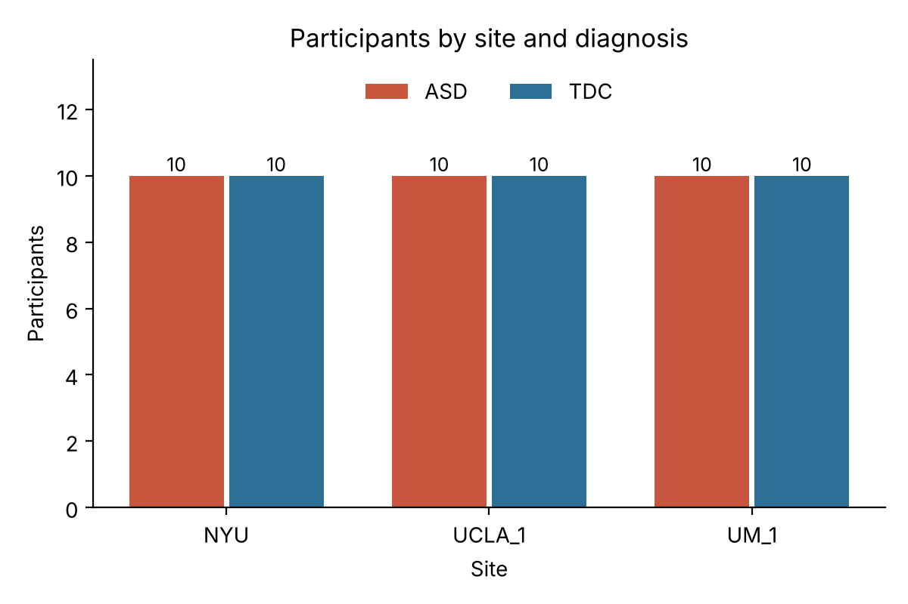
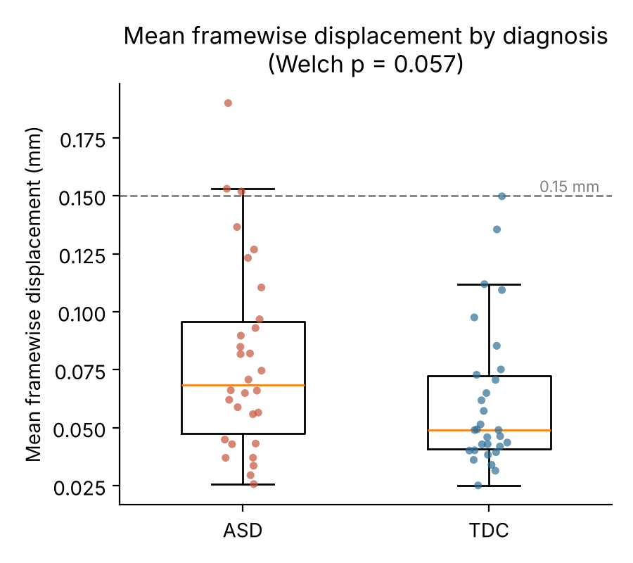
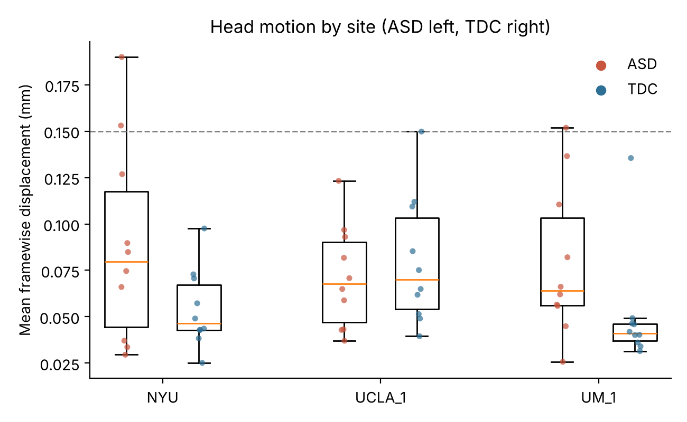

# DATA: Metadata

This file describes the data used in the project. It is the MI2 Data Establishment section, rewritten for markdown and updated to match the current analysis.

## Data Summary

The working cohort has **60 de-identified participants from the Autism Brain Imaging Data Exchange (ABIDE I)** [1]: 20 from each of three sites (NYU, UCLA_1, UM_1), with **10 ASD and 10 typically developing controls (TDC) per site**.

Data files:

| File(s) | Location | What it is |
|---|---|---|
| `participants.csv` | `DATA/initial/` | One row per participant: ID, diagnosis, age, recorded sex, site, mean framewise displacement (FD) |
| `SHA256SUMS.txt` | `DATA/initial/` | Checksums for `participants.csv` and all 60 time-series files; `sha256sum -c SHA256SUMS.txt` (run inside `DATA/initial/`) confirms the files are unchanged |
| `{subject_id}_rois_cc200.1D` (60 files) | `DATA/initial/timeseries/` | Preprocessed resting-state fMRI time series averaged within the 200 regions of the CC200 atlas [4]; one row per time point, one column per region |
| `fc_features.npz` | `DATA/final/` | Final analysis data made by `SCRIPTS/01_check_data_and_build_features.py`: a 60 × 19,900 matrix of Fisher-z functional connectivity (FC) values plus the matching subject IDs |
| `analysis_cohort.csv` | `DATA/final/` | Copy of the participant metadata in the same row order as `fc_features.npz` |

From the initial to the final data: for each person, the 200 regional time series are correlated with each other (Pearson r), giving a 200 × 200 FC matrix. Correlations are Fisher-z transformed (arctanh), and the 19,900 unique values above the diagonal become that person's feature vector. All steps are in script 01, so the final data can be rebuilt from the initial data.

## Provenance

ABIDE I pools resting-state fMRI, structural MRI and phenotypic data that many international sites collected independently and shared through the International Neuroimaging Data-sharing Initiative (INDI) [1]. The regional time series used here come from the Preprocessed Connectomes Project (PCP) release of ABIDE, where the ABIDE data were preprocessed by several independent teams, each with its own pipeline [2]. PCP file names use a `FILE_ID` built from the site and subject ID, which links each time-series file to its phenotypic record [2].

This project uses a selected subset: three sites, 10 ASD and 10 TDC per site. We use the derived CC200 time series, not raw MRI volumes. The 60 files were checked against `SHA256SUMS.txt` and all matched. Scan length differs by site (176, 116 and 296 time points for NYU, UCLA_1 and UM_1), which reflects different acquisition protocols (see `OUTPUT/tables/data_quality_checks.csv`).

Within each site, each ASD participant is paired with a TDC participant of the same recorded sex and nearly the same age (for example NYU_0050956 and NYU_0051051, both female, age 14.06), so the two groups end up matched on age and sex. Still to document: the exact PCP pipeline and denoising strategy the time series came from.

## License

The original ABIDE I data were released under the Creative Commons Attribution-NonCommercial-ShareAlike (CC BY-NC-SA) license [1], [5]. For the PCP derivatives, following 1000 Functional Connectomes Project policy, use is unrestricted for non-commercial research [3]; the PCP project itself is listed under a BSD license [6].

We use the data only for non-commercial coursework, acknowledge ABIDE and PCP as the sources, and share the data files in this repository under the same CC BY-NC-SA terms. The code in `SCRIPTS/` is under the MIT license (`LICENSE.md`); that license does not apply to the data.

## Ethical Statements

* Participants are identified only by de-identified ABIDE IDs. We do not try to re-identify anyone or link these data to other sources.
* Diagnosis labels come from the original ABIDE sites. We did not verify them independently.
* Model predictions are a research result on 60 people. They are not a diagnostic tool and should not be read as one.
* The sample is small, mostly male, and from three sites only, so results may not hold for other groups, ages or scanners.
* Head motion and site differences can create FC differences that look like group effects [7]. We check both (leave-one-site-out testing and a motion sensitivity analysis) and report the results whether or not they support the main finding.

## Data Dictionary

| Variable | Type | Meaning | Values / units | Notes and uncertainty |
|---|---|---|---|---|
| `subject_id` | string | De-identified ABIDE ID in PCP `FILE_ID` form (site + subject number) | e.g. `NYU_0050956` | Matches the time-series file name; all 60 matched |
| `diagnosis` | categorical | Diagnostic group | `ASD`, `TDC` | Label from source site; ASD coded 1 in models |
| `age` | float | Age at scan | years (range 8.79–23.66) | ASD and TDC are age-matched (means 13.91 vs 13.93) |
| `sex` | categorical | Recorded sex | `F`, `M` | 4 F / 26 M in each group; source-defined |
| `site` | categorical | Imaging site | `NYU`, `UCLA_1`, `UM_1` | Scanner and protocol differ across sites |
| `mean_fd` | float | Mean framewise displacement, a summary of head motion during the scan | mm | Definition depends on the preprocessing pipeline; 0.15 mm is the cut-off for the sensitivity analysis |
| CC200 time series | float matrix | Mean BOLD signal in each CC200 region at each time point | T × 200 | T = 176 (NYU), 116 (UCLA_1), 296 (UM_1); no missing values or constant regions |
| FC matrix | float matrix | Fisher-z correlation between every pair of regions | 200 × 200 | Sensitive to motion and noise |
| FC feature vector (`X`) | float vector | Upper triangle of the FC matrix | 19,900 values per person | Far more features than people (60) |

## Explanatory Plots

Both plots are made by `SCRIPTS/02_exploratory_analysis.py`.

**Figure 1. Participants by site and diagnosis.** Every site contributes 10 ASD and 10 TDC participants, so diagnosis is not tied to site.

**Figure 2. Mean framewise displacement by diagnosis.** Each dot is one person; the dashed line marks the 0.15 mm cut-off used in the motion sensitivity analysis. ASD participants moved more on average (mean FD 0.080 vs. 0.061 mm, Welch p = 0.057), and the only three people above 0.15 mm are all ASD. This is why motion is treated as a possible confound and tested in the sensitivity analysis.

**Figure 3. Mean framewise displacement by site and diagnosis.**

## References

[1] A. Di Martino *et al.*, "The autism brain imaging data exchange: Towards a large-scale evaluation of the intrinsic brain architecture in autism," *Molecular Psychiatry*, vol. 19, no. 6, pp. 659–667, 2014, doi: 10.1038/mp.2013.78.

[2] Preprocessed Connectomes Project, "ABIDE Preprocessed." [Online]. Available: https://preprocessed-connectomes-project.github.io/abide/

[3] Nilearn, "ABIDE PCP dataset." [Online]. Available: https://nilearn.github.io/dev/modules/description/ABIDE_pcp.html

[4] R. C. Craddock, G. A. James, P. E. Holtzheimer, X. P. Hu, and H. S. Mayberg, "A whole brain fMRI atlas generated via spatially constrained spectral clustering," *Human Brain Mapping*, vol. 33, no. 8, pp. 1914–1928, 2012, doi: 10.1002/hbm.21333.

[5] International Neuroimaging Data-sharing Initiative, "Autism Brain Imaging Data Exchange (ABIDE)." [Online]. Available: http://fcon_1000.projects.nitrc.org/indi/abide/

[6] NITRC, "Preprocessed Connectomes Project." [Online]. Available: https://www.nitrc.org/projects/pcp/

[7] J. D. Power, K. A. Barnes, A. Z. Snyder, B. L. Schlaggar, and S. E. Petersen, "Spurious but systematic correlations in functional connectivity MRI networks arise from subject motion," *NeuroImage*, vol. 59, no. 3, pp. 2142–2154, 2012, doi: 10.1016/j.neuroimage.2011.10.018.
